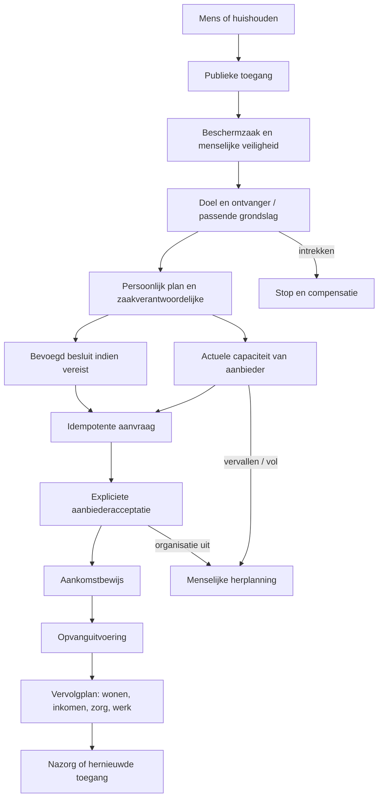

# RTG CIVILIS — integrale ketenarchitectuur en uitvoeringsregister

Dit document is de uitvoeringsbijlage bij `CIVILIS.md`. Het is geen tweede
platform, productcatalogus of completion-register. `APPWERKT.json` blijft de
enige bron die een app voltooid mag noemen; ketenproeven blijven de bron voor
ketenbewijs. Dit document legt de architectuur, de repository-audit, de open
beslispunten en de huidige ontwikkelstand bij elkaar.

**Meetdatum:** 10 november 2026. **Bronstand:** commit `290144d6411b81644dfb407365932c35a58ab277`
plus de wijzigingen van deze uitvoering. Een codeverwijzing bewijst dat code
bestaat, niet dat een externe organisatie haar heeft geaccepteerd of dat zij in
productie operationeel werkt.

## 1. Missie en systeemgrens

RTG CIVILIS is maatschappelijke infrastructuur voor menselijke
bestaanszekerheid. Het verbindt burgers, huishoudens, maatschappelijke
organisaties, professionals, publieke instellingen en financiers voor toegang,
bescherming, ondersteuning, ontwikkeling en maatschappelijke deelname.

Het stelsel coördineert hulpvragen, rechten, plannen, bevoegdheden, capaciteit,
uitvoering, bewijs, middelen, verantwoording en nazorg. Het neemt nooit het
wettelijke gezag van een deelnemende organisatie over. Een gemeente blijft
eigenaar van haar besluit, een zorgverlener van het medisch dossier, een
opvangaanbieder van de plek en een werkgever van de arbeidsrelatie.

CIVILIS is daarom federatief:

- geen universeel burgerdossier, sociale score of centrale risicoranglijst;
- geen organisatie schrijft rechtstreeks in het dossier van een andere;
- de gedeelde laag draagt verwijzingen, doel, gezag, minimale gegevens,
  bewijs, fouttoestand, compensatie, audit en een verantwoordelijke;
- de domeinkern beslist zelf of een overgang mag. `server/kern/civilis/contract.js`
  is een taal- en vormcontract, geen generieke uitvoeringsmachine;
- een mens kan terugkeren, meerdere trajecten tegelijk hebben of langdurig
  ondersteund blijven. Dat is een geldige uitkomst en geen systeemfout.

## 2. De tien fasen

De fasen zijn gelijktijdig en herhaalbaar. Zij vormen geen verplichte trechter.

| # | Fase | Betekenis | Minimale garantie |
|---|---|---|---|
| 1 | Toegang | Een mens of vertegenwoordiger kan hulp beginnen | Ook zonder account, telefoon of adres; geen verloren melding |
| 2 | Veiligheid | Direct gevaar en veilige communicatie worden menselijk beoordeeld | Spoedkanaal eerlijk; geen schijnalarmcentrale |
| 3 | Begrijpen | Behoefte, context en wat juist niet gedeeld mag worden | Dataminimalisatie per dataklasse |
| 4 | Plan en regie | Doelen, parallelle trajecten, afhankelijkheden en eigenaar | Begrijpelijke burgerroute en één aanspreekpunt per zaak |
| 5 | Bevoegd besluit | Een bevoegde partij neemt een formeel of operationeel besluit | Software adviseert of geleidt; zij eigent zich geen gezag toe |
| 6 | Toewijzing en acceptatie | Opdracht, capaciteit en ontvanger worden verbonden | Geen bevestiging zonder acceptatie door de uitvoerder |
| 7 | Uitvoering | De dienst, voorziening of begeleiding vindt plaats | Werk, bevoegdheid, veiligheid en vervolg zijn zichtbaar |
| 8 | Resultaat en bewijs | Levering, resultaat, verklaring en financiële aansluiting | Dienst, resultaat en maatschappelijk effect blijven drie bewijsvormen |
| 9 | Vervolg en deelname | Wonen, leren, werk, netwerk of duurzame ondersteuning | Overgangen verdwijnen niet tussen organisaties |
| 10 | Nazorg en hernieuwde toegang | Vrijwillige opvolging, herstel en terugkeer | Geen stigma, geen onnodige herintake, menselijke herbeoordeling |

De canonieke namen staan in `server/kern/civilis/contract.js` en worden door
`test/civilis-contract.test.js` op aantal, uniciteit en contractvorm bewaakt.

## 3. Twaalf domeinen, zes lagen en vijftien motorverantwoordelijkheden

De twaalf domeinen zijn: veiligheid en crisis; wonen; inkomen; schulden en
geld; gezondheid; onderwijs; werk; gezin en jeugd; ouderen en beperkingen;
recht en identiteit; mobiliteit en digitaal; gemeenschap en participatie.

Zij gebruiken zes gedeelde lagen:

1. mens en huishouden;
2. levenssituatie en trajecten;
3. organisaties en bevoegdheden;
4. mensen en middelen;
5. transacties en bewijs;
6. vertrouwen en continuïteit.

De lagen delen contractvormen, geen vertrouwelijke inhoud. Een huishoudplan mag
bijvoorbeeld zeggen dat een gezondheidsafhankelijkheid de afspraak beïnvloedt,
maar neemt geen diagnose over. Een werkgever krijgt geen zorgdossier; een
gemeentelijke contractmanager geen individuele hulpvraag.

### Audit van de vijftien motoren

De classificatie is steeds één van: **bestaand en bewezen**, **bestaand maar
onvoldoende bewezen**, **gedeeltelijk geïmplementeerd**, **ontbrekend**,
**extern afhankelijk**, of **juridisch/operationeel geblokkeerd**.

| Motor | Classificatie | Aanwezige bron | Grootste open naad |
|---|---|---|---|
| Toegang | Bestaand en bewezen | publieke deur in `beschermzaak/voordeur.js`; `wegwijzer.html`; `test/beschermzaak.test.js` | 24/7 menselijke bezetting is extern |
| Veiligheid | Bestaand en bewezen | eigen beschermklasse, veiligheidsvraag, minimale gegevens en intrekken | geen geïntegreerde professionele triagedienst |
| Identiteit | Gedeeltelijk geïmplementeerd | codenamen, identiteitskluis, codelevenscyclus, machtigingen | herstel van ontbrekende identiteit en federatieve identificatie |
| Rechten | Gedeeltelijk geïmplementeerd | genre- en bevoegdheidspoorten, fiscale zekerheidsklassen, hulpwijzers | actuele regelingen, voorwaarden en formele publieke besluitkoppelingen |
| Plan | Gedeeltelijk geïmplementeerd | Servicezaak, casusstappen en opvangvervolgplan | parallel persoonlijk en huishoudelijk plan met afhankelijkheden |
| Ketenregie | Gedeeltelijk geïmplementeerd | zaakverantwoordelijke in opvang, Servicezaak, partner- en stadsgrenzen | overdraagbaar regiehouderschap en escalatie bij uitval |
| Capaciteit | Gedeeltelijk geïmplementeerd | activiteiten, voorraad en `rtfos/opvang.js` met vervallende beschikbaarheid | echte aanbiedersfeeds, reserveringsconcurrency en alternatieven |
| Overdracht | Bestaand maar onvoldoende bewezen | casuskoppeling, beschermzaakoverdracht, partnerportaal, opvangacceptatie | externe warme overdracht en bereikbaarheid in productie |
| Werk | Bestaand maar onvoldoende bewezen | veldtoewijzing, vrijwilligers, personeel/roosters en bevoegdheden | ketenbrede werklast, vervanging en veiligheid per beroepsgroep |
| Middelen | Gedeeltelijk geïmplementeerd | geoormerkt geld, projecten, voorraad, subsidies, uitgaven met vier ogen | gemeentelijke opdrachten, voorzieningen en contractbudgetten |
| Bewijs | Bestaand maar onvoldoende bewezen | auditsporen, projectbewijs, `APPWERKT.json`, ketenproeven | uniforme scheiding dienst/resultaat/effect voor maatschappelijke ketens |
| Financieel | Gedeeltelijk geïmplementeerd | Pay, grootboeken, factuur- en aansluitingstoetsen | opvangopdracht, prestatie, declaratie, correctie en echte betaalrail |
| Herstel | Gedeeltelijk geïmplementeerd | Zaakdoos, outbox, herstel- en sabotage-instrumenten | opvangketen offline, organisatie-uitval en compensatieproef |
| Evaluatie | Gedeeltelijk geïmplementeerd | klachten, risico, rapportage en Living Lab-bewijsgraden | ervaringsmeting, onafhankelijke toets en causale effectgrens |
| Preventie | Juridisch/operationeel geblokkeerd | vrijwillige nazorg bestaat in casussen | geen profilering; grondslag, proportionaliteit en menselijke beoordeling per signaal ontbreken |

Geen rij hierboven verhoogt een APPWERKT- of Deep Green-teller.

## 4. Capability-matrix

| Capability | Classificatie | Bewijsanker | Grens of afhankelijkheid |
|---|---|---|---|
| Hulp starten zonder account | Bestaand en bewezen | `/api/bescherming/deur/start`; beschermzaaktoets 8 | alleen actieve stad met module |
| Geen naam/adres/BSN in veiligheidszaak | Bestaand en bewezen | `beschermzaak/klasse.js`; toets 1 | andere organisatiekluis valt buiten de zaak |
| Eigen statuscode en intrekken | Bestaand en bewezen | voordeur `stand`/`intrekken`; toetsen 11-12 | code is bewust geen volledige authenticatie |
| Menselijke veiligheidsbeoordeling | Bestaand en bewezen | beschermzaakketen | 24/7 bezetting niet geleverd |
| Doelgebonden toestemming per ontvanger | Bestaand en bewezen | `beschermzaak/toestemming.js`; toetsen 3-4 | toestemming is niet altijd de juiste publieke grondslag |
| Organisatie- en stadsbevoegdheid | Bestaand en bewezen | `rtfos/basis.js`; context- en RTFOS-toetsen | sectorbevoegdheden moeten per functie worden toegevoegd |
| Partnererkenning en overeenkomst | Bestaand en bewezen | `rtfos/partners*.js`; RTFOS-toetsen | echte juridische geldigheid extern |
| Gemeentebeeld zonder individueel dossier | Bestaand en bewezen | `rtfos/gemeente.js`; beschermzaaktoets 7 | kleine aantallen en beleidsanalyse nog uitwerken |
| Persoonlijke burgerroute | Gedeeltelijk geïmplementeerd | publieke opvangfase in `wegwijzer.html` | nog geen multi-domeinroute, telefoon/print/voorleesvorm |
| Huishoudplan met afgeschermde deeltrajecten | Ontbrekend | ontwerp in dit document | vertegenwoordiging, kindrechten en doelen per relatie nodig |
| Parallelle trajecten met afhankelijkheden | Ontbrekend | contract ondersteunt verwijzing, geen uitvoerder | domeineigen toestandmachines moeten aansluiten |
| Zaakverantwoordelijkheid | Gedeeltelijk geïmplementeerd | `opvangreserveringen.verantwoordelijke` | overdracht, afwezigheid en escalatie ontbreken |
| Actuele opvangcapaciteit | Gedeeltelijk geïmplementeerd | `rtfos/opvang.js`; CIVILIS-opvangtest | alleen handmatig en gesimuleerd; geen echte feed |
| Idempotente opvangaanvraag | Geïmplementeerd, gesimuleerd | `opvang.aanvraag`; opvangtest | proces-/databaseconcurrency nog niet als storing beproefd |
| Acceptatie uitsluitend door aanbieder | Geïmplementeerd, gesimuleerd | partnerroute `opvang/besluit`; opvangtest | geen externe acceptatieverklaring |
| Verval vóór aankomst | Geïmplementeerd, gesimuleerd | `opvang.verval`; opvangtest | crash- en raceproef ontbreken |
| Aankomstbewijs door aanbieder | Geïmplementeerd, gesimuleerd | partnerroute `opvang/aankomst`; opvangtest | geen balie-, QR- of offline bewijs |
| Noodplaats vóór regulier budgetbesluit | Geïmplementeerd, gesimuleerd | financiering `nood_voor_besluit` met reden | nabetaling en bevoegd besluit ontbreken |
| Vervolgplan na aankomst | Geïmplementeerd, gesimuleerd | `opvang/vervolgplan`; opvangtest | geen afhankelijkheden, heropening of huishoudscope |
| Warme overdracht naar volgende organisatie | Gedeeltelijk geïmplementeerd | beschermzaak + opvang | acceptatie door vervolgaanbieder ontbreekt |
| Opdracht-prestatie-factuur-betaling | Ontbrekend voor opvang | financiële kernen bestaan elders | contract, tarief, functiescheiding en echte rail nodig |
| Offline opvanguitvoering | Ontbrekend | Zaakdoos bestaat generiek | dataklasse, conflictregel en herstelproef ontbreken |
| Aggregaat capaciteitsbeeld | Ontbrekend | rapportagelaag bestaat | kleine-aantallenbescherming en actualiteitslabel nodig |
| Voorspellende planning zonder persoonsprofiel | Juridisch/operationeel geblokkeerd | alleen ontwerp | DPIA/grondslag, bias, doel en menselijke controle nodig |
| Operationele productieverklaring | Extern afhankelijk | `APPWERKT.json` en Deep Green blijven leidend | echte gemeente/aanbieder, SLA, security en live ketenproef nodig |

## 5. Afhankelijkheidsgraaf

De pijlen zijn afhankelijkheden. Zij geven geen organisatie automatisch het
recht om de volgende stap te zetten.

## 6. Het gedeelde ketencontract

`server/kern/civilis/contract.js` definieert de envelop. Iedere gebeurtenis
draagt: gebeurtenis-id, keten en overgang, fase en domein, actor, bevoegdheid,
grondslagbeslispunt, doel, tenant, zaak, geminimaliseerde onderwerpverwijzing,
idempotentiesleutel, gedeelde veldnamen, bewijsverwijzingen, fouttoestand,
compensatie, auditsoort, verantwoordelijke en tijdstip.

De envelop bevat geen naam, BSN, diagnose, adres, telefoon of e-mail als
topveld. Dat is een ondergrens, geen volledige AVG-toets. Domeinen mogen
strengere dataklassen gebruiken, zoals de beschermzaak al doet.

### Overgangen van de opvangketen

| Overgang | Actor en bevoegdheid | Grondslagbeslispunt | Minimale gegevens en bewijs | Fout en compensatie | Verantwoordelijke |
|---|---|---|---|---|---|
| hulp gestart | mens; publieke deur | OPV-01 toegang zonder account | stad, veiligheidsantwoorden, bewaarkeuze; ontvangstspoor | geen actieve stad → eerlijk extern kanaal | RTF-stadsafdeling |
| veiligheid beoordeeld | bevoegde medewerker | OPV-02 vitaal belang/taak/rol bepalen | codenaam, veiligheidsantwoord; audit | onveilig → directe menselijke escalatie | zaakbehandelaar |
| ontvanger bepaald | mens + medewerker | OPV-03 doel en juiste grondslag | aanbiedernaam en toestemmings- of grondslagtekst | intrekken → terug en stop | zaakbehandelaar |
| nood-/budgetpad gekozen | bevoegde beslisser | OPV-04 opdracht- en financieringsgezag | alleen status en reden; besluitref waar aanwezig | nood mag hulp niet blokkeren; later aansluiten | financierende partij |
| capaciteit gemeld | opvangaanbieder | OPV-05 mandaat voorziening | voorziening, beschikbaar aantal, vervaltijd | oud/vol → niet bevestigen | opvangaanbieder |
| plek aangevraagd | zaakverantwoordelijke | OPV-06 doelbinding en bevoegdheid | zaakref, voorzieningref, financieringsstand, idem | duplicate → zelfde antwoord | zaakverantwoordelijke |
| plek geaccepteerd | opvangaanbieder | OPV-07 contract en operationele bevoegdheid | reservering, voorziening, vervaltijd; acceptatie | weigering/vol → alternatief | opvangaanbieder |
| aankomst bevestigd | opvangaanbieder | OPV-08 uitvoeringsbevoegdheid | reserveringref en tijd; aankomstspoor | niet verschenen/verlopen → herplanning | opvangaanbieder |
| opvang uitgevoerd | uitvoerende organisatie | OPV-09 sectorregels en contract | dienstbewijs, geen diagnose in keten | uitval/incident → herstelroute | uitvoerder |
| resultaat vastgelegd | mens + uitvoerder | OPV-10 doel en proportionaliteit | dienst, resultaat, ervaring apart | verschil van inzicht → correctie/klacht | zaakverantwoordelijke |
| vervolg geaccepteerd | volgende bevoegde organisatie | OPV-11 nieuwe doelbinding/grondslag | beperkt overdrachtssetje en acceptatie | weigering → plan herzien | ontvangende partij |
| verantwoording aangesloten | functiescheiding | OPV-12 contract/financieel recht | opdracht, prestatie, factuur, betaling als refs | mismatch → blokkeren/corrigeren | financier + uitvoerder |
| nazorg/heropening | mens of bevoegde professional | OPV-13 vrijwilligheid of publieke taak | doel, contactvorm, nieuwe zaakref indien nodig | geen contact → geen nadelig oordeel | zaakverantwoordelijke |

De OPV-nummers zijn beslispunten voor jurist, FG/DPO, opdrachtgever en
uitvoerder. Zij zijn geen ingevulde wettelijke grondslagen.

## 7. Privacy, huishoudens en maatschappelijke bescherming

Een huishouden krijgt een **samenwerkingsprojectie**, geen samengevoegd dossier.
Die projectie bevat een huishoudref, gezamenlijke doelen, afhankelijkheden,
zichtbaarheidslabels en verwijzingen naar individuele trajecten. Ieder traject
houdt zijn eigen tenant, dataklasse, grondslag, bewaartermijn en rechten.

Een netwerkrelatie krijgt vier eigenschappen: rol (mantelzorger,
vertegenwoordiger, vertrouwenspersoon of vrijwilliger), doel, scope en verval.
Wettelijke vertegenwoordiging en vrijwillige machtiging zijn verschillende
bronnen van bevoegdheid en worden nooit tot één vinkje gereduceerd.

Voor echte persoonsgegevens moeten minimaal deze beslispunten worden gesloten:

| ID | Vraag vóór verwerking of vrijgave |
|---|---|
| J-01 | Wie is verwerkingsverantwoordelijke en wie verwerker per overgang? |
| J-02 | Welke wettelijke taak, overeenkomst, vitaal belang of toestemming draagt precies deze verwerking? |
| J-03 | Is toestemming vrij, specifiek en intrekbaar in deze machtsverhouding? |
| J-04 | Welke sectorwet of beroepsgeheim begrenst delen, ook als de AVG een basis zou toelaten? |
| J-05 | Welke velden zijn noodzakelijk, wie ziet ze en hoe lang? |
| J-06 | Vereist de functie een DPIA, medezeggenschap, archiefbesluit of onafhankelijke toets? |
| J-07 | Hoe werken inzage, correctie, beperking, bezwaar en vertegenwoordiging? |
| J-08 | Welke kleine-aantallendrempel voorkomt herleidbaarheid in aggregaten? |
| J-09 | Wat gebeurt bij noodtoegang, wie beoordeelt haar achteraf en wie wordt geïnformeerd? |
| J-10 | Valt een analyse onder toepasselijke AI-regels en hoe blijft het besluit aantoonbaar menselijk? |

Preventie gebruikt geen automatische kwetsbaarheidsscore. Een signaal wordt
alleen verwerkt na een functie-specifiek besluit over doel, bron, grondslag,
proportionaliteit, transparantie en menselijke beoordeling. Geen reactie op een
aanbod mag automatisch een nadelige beslissing opleveren.

## 8. Eerste verticale keten: geen veilige slaapplek

De huidige implementatie hergebruikt:

- publieke toegang en beschermzaak: `server/kern/beschermzaak/`;
- federatieve stads-, rol- en modulepoort: `server/kern/rtfos/basis.js`;
- partnerregister, overeenkomst en bevoegdheden: `server/kern/rtfos/partners*.js`;
- codegebonden partnerportaal: `server/kern/codekoppel.js` en de bestaande
  account-plus-codevorm;
- audit en opslag: de bestaande RTFOS-context;
- burgerweergave: `public/apps/foundation/wegwijzer.html`.

Nieuw is alleen de ontbrekende naad in `server/kern/rtfos/opvang.js` en
`server/routes/rtfos/opvang.js`: voorziening, vervallende capaciteit,
idempotente aanvraag, expliciete acceptatie of weigering, aankomst,
zaakverantwoordelijke, noodfinancieringsstand, vervolgplan en compensatie bij
intrekken. Er is geen adresveld, geen naamveld en geen tweede casus.

### Huidige bewijsstand

| Onderdeel | Ontwerp | Code | Gesimuleerde integratietest | Externe acceptatie | Operationeel bewezen |
|---|---:|---:|---:|---:|---:|
| Publieke melding en veiligheidsklasse | ja | ja | ja | nee | nee |
| Gerichte toestemming en intrekken | ja | ja | ja | nee | nee |
| Partner- en tenantgrens | ja | ja | ja | nee | nee |
| Actuele capaciteit met verval | ja | ja | ja | nee | nee |
| Idempotente aanvraag | ja | ja | ja | nee | nee |
| Acceptatie uitsluitend door aanbieder | ja | ja | ja | nee | nee |
| Aankomst en vervolgplan | ja | ja | ja | nee | nee |
| Echte opvangplek | ja | nee | nee | nee | nee |
| Gemeentelijk opdracht-/budgetbesluit | deels | nee | nee | nee | nee |
| Prestatie, declaratie en echte betaling | deels | nee | nee | nee | nee |
| Offline en organisatie-uitval | deels | nee | nee | nee | nee |

`test/civilis-opvang.test.js` bewijst op een wegwerpserver de eerste zeven
rijen op software-integratieniveau. Het script `npm run civilis:opvang` omvat
die proef en het contract. Dit is nadrukkelijk geen productie-vrijgave.

## 9. Integrale testmatrix

| Scenario | Positief bewijs | Negatieve/storingsproef | Stand |
|---|---|---|---|
| Geen account/adres/telefoon | publieke start geeft code | identiteitsvelden worden geweigerd | groen, gesimuleerd |
| Geen actuele capaciteit | aanvraag blijft aangevraagd | acceptatie wordt 409 | groen, gesimuleerd |
| Beschikbare plek | aanbieder meldt en accepteert | alleen aanbieder kan besluiten | groen, gesimuleerd |
| Dubbele aanvraag | dezelfde idem geeft hetzelfde id | tweede open intentie wordt geweigerd | groen, gesimuleerd |
| Andere tenant | eigen lijst is leeg | besluit op andermans aanvraag is 404 | groen, gesimuleerd |
| Toestemming ingetrokken | reservering stopt, plek komt terug | aankomst kan niet doorlopen | groen, gesimuleerd |
| Weigering | reden en alternatiefstatus | weigeren zonder reden wordt geweigerd | groen, gesimuleerd |
| Ontbrekende identiteit | beschermzaak werkt zonder identiteit | formeel vervolg dat identiteit eist | toegang groen; herstel ontbreekt |
| Conflicterende gegevens | — | capaciteit/zaak/partner spreken elkaar tegen | deels; gerichte proef ontbreekt |
| Verlopen acceptatie | vervalpad bestaat | aankomst na verval wordt geweigerd | groen, gesimuleerd |
| Netwerk-/procesuitval | — | herstart tussen aanvraag en acceptatie | ontbreekt |
| Offline werk | — | journaal, sync, conflict, intrekken | ontbreekt |
| Mislukte betaling | noodroute blokkeert opvang niet | declaratie/betaling faalt | financieel deel ontbreekt |
| Onbereikbare medewerker | — | eigenaar/escalatie/vervanging | ontbreekt |
| Uitvallende aanbieder | — | herplanning zonder gegevenslek | ontbreekt |
| Toegankelijkheid | bestaande Wegwijzer is toetsenbordbaar | voorlezen, taal, print, loket | browser/a11y-hermeting vereist |

Vóór de volgende maatschappelijke keten moeten minimaal de ontbrekende crash-,
offline-, toegankelijkheids- en echte partnerproeven groen zijn.

## 10. Bouw- en vrijgavevolgorde

1. **Contract en audit sluiten.** Deze bijlage, het codecontract en de
   capability-matrix blijven op concrete ankers; geen handmatige groene teller.
2. **Opvangkern harden.** Transactionele concurrency, vervalklok, weigering,
   heropening, zaakoverdracht en uitval van medewerker/aanbieder beproeven.
3. **Burger- en professionalweergave afmaken.** Begrijpelijke parallelle route,
   telefoon-, loket-, print-, taal- en voorleesvorm; geen interne dossiers.
4. **Opdracht en geld aansluiten.** Formeel besluit waar vereist, nooduitzondering,
   prestatie, factuur, correctie en betaling met functiescheiding.
5. **Zaakdoos koppelen.** Alleen de opvangsubset, met tenantversleuteling,
   intrekking, conflictregels en een geslaagde herstelproef.
6. **Externe proeftuin.** Eén echte gemeente/financier en één echte aanbieder,
   contractueel en technisch begrensd; geen fictieve acceptatie.
7. **Integrale ketenproef.** Positief, negatief, privacy, security,
   toegankelijkheid, storing, herstel en menselijke ervaring.
8. **Bestaande bewijsregisters verversen.** Pas daarna APPWERKT, ketenregister,
   Experience en Deep Green volgens `AFBOUWPROGRAMMA.md`.
9. **Vrijgavebesluit.** Een mens tekent; productie volgt nooit automatisch.
10. **Pas daarna een volgende keten.** Voorkeur: dreigende huisuitzetting,
    omdat die dezelfde wonen-, inkomen-, schuld- en rechtsnaden hergebruikt.

## 11. Maatschappelijke waarde

CIVILIS meet niet alleen handelingen. Per keten worden drie soorten bewijs apart
gehouden:

- **dienst:** is de afgesproken prestatie geleverd, door wie en wanneer;
- **resultaat:** is de concrete situatie veranderd, en volgens wie;
- **effect:** is een bredere duurzame verandering aannemelijk, met welke
  methode en onzekerheid.

Voor opvang zijn de eerste kernmaten: tijd tot menselijke beoordeling, tijd tot
aanbiederacceptatie, mislukte overdrachten, vervallen reserveringen, aankomst,
tijd tot vervolgplan, heropening, ervaren toegankelijkheid en behoud van eigen
regie. Kosten zijn een afzonderlijke maat en nooit de enige definitie van
succes.

Een geaccepteerde plek zonder aankomst is geen geleverde dienst. Een overnachting
is geen duurzame woonuitkomst. Een duurzame woonuitkomst bewijst op zichzelf
niet dat CIVILIS haar heeft veroorzaakt.

## 12. Vrijgavenorm

De eerste opvangketen is nu **geïmplementeerd en gesimuleerd**, niet extern
geaccepteerd en niet operationeel bewezen. CIVILIS mag pas een volgende
maatschappelijke keten vrijgeven wanneer deze keten met echte bevoegde partijen,
echte capaciteit, de volledige storingsmatrix en de bestaande Deep
Green-criteria aantoonbaar werkt.

De norm blijft: geen verloren mens, geen schijnbevestiging, geen onbevoegde
inzage, geen ongecontroleerde euro en geen onomkeerbare automatisering.
