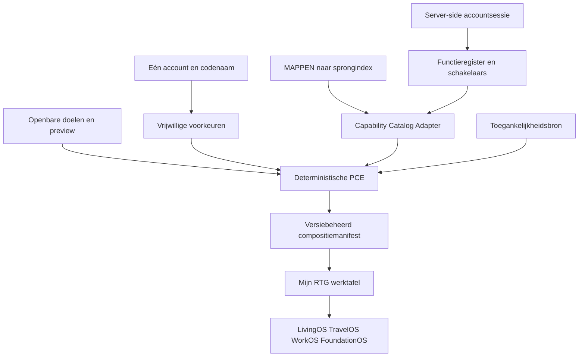

# RTG PersonalOS — persoonlijke compositie zonder tweede platform

**Meetdatum:** 10 november 2026. **Bronstand:** commit
`290144d6411b81644dfb407365932c35a58ab277` plus de wijzigingen van deze
uitvoering. Dit document is een architectuur- en bewijsregister. Het verhoogt
geen APPWERKT- of Deep Green-status.

## 1. Besluit en grens

PersonalOS is geen 115e app, tweede accountmodel, nieuwe wereld of zelfstandige
AI-agent. Het is een capability binnen de bestaande Experience- en Mijn
RTG-lagen die een persoonlijke werktafel samenstelt uit bestaande bronnen.

Vier verantwoordelijkheden blijven gescheiden:

1. De Authority Engine bepaalt welke capability voor deze sessie en doelgroep
   toonbaar is. Iedere beschermde handeling autoriseert daarna opnieuw.
2. De Personal Composition Engine ordent alleen wat die grens doorlaat.
3. De gebruiker bepaalt doelen, vastgezette functies, verborgen suggesties en
   de wereldvolgorde.
4. Rahul kan later voorstellen doen, maar is niet nodig op het kritieke pad en
   kan nooit toegang verlenen.

De motor rangschikt capabilities, geen mensen. De uitkomst mag nooit worden
gebruikt voor hulpprioriteit, krediet, schaarse capaciteit, toelating,
arbeidsbesluiten of een kwetsbaarheidsscore.

## 2. Repository-audit

| Onderdeel | Classificatie | Bestaande bron | Besluit |
|---|---|---|---|
| Eén account voor meerdere rollen | Bestaand en bewezen | `server/routes/auth/account.js`; `server/kern/eenaccount/` | hergebruiken |
| Identiteitskluis en codenamen | Bestaand en bewezen | `server/accounts/dossier.js`; `server/accounts/gebonden.js` | compositie uitsluitend aan interne referentie koppelen |
| Vier werelden | Bestaand en bewezen | `WERELDEN.md`; `server/kern/experience/manifesten.js` | geen vijfde PersonalOS-wereld |
| Serverprojecties en contexten | Bestaand maar onvoldoende bewezen voor alle rollen | `server/kern/experience/` | projecties hergebruiken; organisatiecontexten nog integraal bewijzen |
| Zichtbare appcatalogus | Bestaand en bewezen als gegenereerde bron | `MAPPEN` in `public/apps/app-main.js`; `public/shared/sprongindex.json` | geen tweede catalogus |
| Capability-/doelgroepbeleid | Bestaand en bewezen | `server/functies/register/`; `server/functies/toegang.js` | Authority Adapter leest deze bron fail-closed |
| Persoonlijke schermindeling | Bestaand en bewezen | `server/kern/workspace-voorkeur.js`; `public/shared/interface/workspace-continuity.js` | niet opnieuw opslaan in PersonalOS |
| Toegankelijkheidsprofiel | Bestaand en bewezen | `server/kern/toegankelijk.js` | alleen projecteren, niet dupliceren |
| Vrijwillige voorkeuren/neigingen | Bestaand en bewezen | `server/kern/neiging/` | doelen zijn expliciet en apart; geen afgeleide doelgroep |
| Persoonlijke vertrouwenslaag | Bestaand, breder programma | `MIJNRTG.md` | PersonalOS componeert; Mijn RTG blijft controle- en bewijslaag |
| Deterministische persoonlijke compositie | **Geïmplementeerd, lokaal bewezen** | `server/kern/personalos/`; `test/personalos*.test.js` | eerste verticale kernproef staat |
| Progressieve onboarding-UI | **Geïmplementeerd en in Chromium bewezen als verticale route** | bestaande registratie, doelen, layout, preview-API, overeenkomst en herkomstvraag | geautomatiseerde mobiele browsertest groen; menselijke toegankelijkheidsproeven blijven open |
| Persoonlijke RTG-werktafel | **Geïmplementeerd en in Chromium bewezen als projectie** | bestaande Command-werktafel en `MAPPEN`; PersonalOS ordent alleen de vier bestaande werelddeuren | werktafel, zichtbare Instellingen-ingang en Mijn RTG-paneel groen; dagelijkse menselijke bediening nog niet compleet |
| Voorkeuren op meerdere apparaten | **Geïmplementeerd en lokaal bewezen** | `preferenceVersion`, conditionele update en HTTP 409 met actuele serverstand | echte synchronisatie onder netwerkuitval nog bewijzen |
| Multi-context activatie en cachewissing | Bestaand in delen, niet integraal bewezen | `server/kern/eenaccount/`, sessieregister, Experience-contexten | geen nieuwe contextknop vrijgeven vóór ketenproef |
| Offline PersonalOS | Geen persoonlijke offline-opslag aanwezig | bestaande PWA en Workspace-continuity | veilig in de zin dat geen PersonalOS-dossier lokaal wordt gekopieerd; offline herstel en synchronisatie zijn niet bewezen |
| AI-voorstellen | Ontbrekend en niet nodig | bestaande Rahul-poort | pas later, opt-in en buiten kritisch pad |

De actuele, uit `MAPPEN` gegenereerde sprongindex bevat 118 bestemmingen. Dat
zijn niet automatisch 118 zelfstandige apps of capabilities: er staan ook tabs
en gedeelde ingangen tussen. De huidige Authority-koppeling omvat bewust 16
capabilities waarvoor zowel een zichtbare ingang als een bestaande
functieschakelaar eenduidig is. De adapter kiest 16 concrete catalogusrijen.
De resterende 102 bestemmingen zijn daarom niet kunstmatig als capability
aangemerkt. Alle blijven via Heel RTG bereikbaar
volgens de bestaande regels, maar worden nog niet automatisch aanbevolen. Een
onzekere koppeling weglaten is veiliger dan een kaart die ten onrechte
bevoegdheid suggereert.

| Catalogusmeting | Actuele stand | Betekenis |
|---|---:|---|
| Bestemmingen geïnventariseerd | 118 | gegenereerde sprongindex; geen appclaim |
| Eenduidige capabilities geïdentificeerd | 16 | route, wereld en Authority-schakelaar gevonden |
| Capabilities aan PersonalOS gekoppeld | 16 | door de adapter fail-closed gefilterd |
| Koppelingen contractmatig bewezen | 16 | concrete route, uniek scherm-eigenaarschap, bestaand bestand en Authority-schakelaar |
| Capabilities afzonderlijk integraal bewezen | 0 | nog geen 16 route-voor-route browserketens met domeinhandeling |
| Overige bestemmingen geclassificeerd | 102 | iedere rij valt aantoonbaar in precies één onderstaande klasse |

De daadwerkelijke ontbrekende dekking is nu als volgt geclassificeerd. Deze
telling wordt bewaakt door `test/personalos-contract.test.js`; een nieuwe of
ongeclassificeerde catalogusrij maakt de proef rood.

| Klasse | Aantal | Betekenis en vervolg |
|---|---:|---|
| Canoniek scherm zonder PersonalOS-binding | 75 | bestaand scherm met precies één eigenaar; pas koppelen wanneer één Authority-schakelaar en routebewijs eenduidig zijn |
| Gedeeld document, fragment of routepreset | 14 | geen nieuwe app; hergebruikt een bestaand document en moet onder diens capability vallen |
| Navigatietab zonder eigen route | 8 | ordening binnen een bestaand scherm; nooit als zelfstandige app tellen |
| OS-handelingsingang zonder eigen route | 5 | Bellen, RTFoundation, Snaps, Videobellen en Werk zijn bestaande handelingen; eerst eigenaar en uitvoeringscontract bewijzen |

## 3. Werkende architectuur



`server/kern/personalos/contract.js` accepteert uitsluitend zeven vrijwillige
doelen, drie layouts, bestaande capability-ids en de vier bestaande werelden.
Onbekende keuzes worden geweigerd. Vrije velden zoals diagnose, schuld,
doelgroep of een door de client opgegeven context worden niet opgeslagen.

`server/kern/personalos/catalog.js` leest naam, wereld en URL uit de bestaande
sprongindex. De kleine bindingstabel koppelt iedere opgenomen zichtbare
capability aan precies één bestaande functieschakelaar. Voor een ingelogde
compositie moeten doelgroep én actuele schakelstand positief zijn. Bij een
onbekende doelgroep is de uitkomst leeg.

`server/kern/personalos/engine.js` is een pure functie. Expliciete pins krijgen
voorrang, daarna gekozen doelen, daarna de stabiele catalogusvolgorde. Verborgen
suggesties verdwijnen alleen uit de persoonlijke selectie; Heel RTG blijft de
onafhankelijke catalogusingang. `compositionVersion` is een hash van catalogus,
voorkeuren, context en autoriteitsrevisie.

`server/kern/personalos/index.js` bewaart alleen het kleine voorkeurenobject in
de reeds versleutelde en aan de accountrij gebonden `member_state`. Effectieve
rechten en gevoelige dossiers worden niet gekopieerd. De contextreferentie
wordt uit de server-side sessie afgeleid en niet uit het verzoek.

Voorkeuren worden conditioneel gewijzigd binnen de bestaande accounttransactie:
lokaal neemt `BEGIN IMMEDIATE` het schrijfslot vóór de revisielezing; in
transactionele productie loopt dezelfde bewerking via de request-lokale
accountwerkkopie en gedeelde PostgreSQL-commit. Een concurrente proef start twee
schrijvers met dezelfde revisie en bewijst dat precies één 200 en één 409 krijgt.

De bestaande registratie toont nu vóór accountbevestiging doelen, een
weergavekeuze en de openbare preview. Na registratie wordt dezelfde
accountssessie gebruikt om de voorkeuren te voltooien en de werktafel te laden.
De Command-werktafel krijgt geen tweede appcatalogus: zij ordent uitsluitend de
vier bestaande werelddeuren aan de hand van het compositiemanifest. In het
bestaande bedieningspaneel kan de gebruiker doelen, layout en toegestane pins
wijzigen.

## 4. Gegevenscontract

Werkelijk opgeslagen onder `member_state.personalOS`:

```json
{
  "schemaVersion": 1,
  "goals": ["ondernemen"],
  "pinnedCapabilities": ["onderneming"],
  "hiddenSuggestions": [],
  "worldOrder": ["livingos", "travelos", "workos", "foundationos"],
  "worldOrderMode": "auto",
  "layout": "balanced",
  "revision": 1,
  "completed": true,
  "updatedAt": "2026-11-10T10:00:00.000Z"
}
```

Niet opgeslagen: effectieve bevoegdheden, gebruiksgeschiedenis, diagnoses,
schulden, dossiers, hulpnotities, organisatiecontext, risicoscore, vrije
onboardingtekst of AI-redenering. Toegankelijkheid blijft in het bestaande
profiel; taal blijft in de bestaande taalbron; workspacevolgorde blijft in de
bestaande Workspace-continuity.

## 5. API-contracten die nu bestaan

| Route | Toegang | Betekenis |
|---|---|---|
| `POST /api/personalos/contract` | openbaar | toegestane doelen en layouts |
| `POST /api/personalos/preview` | openbaar, geremd | preview uit openbare catalogus; `authorizationClaim:false` |
| `POST /api/personalos/preferences` | eigen account | canonieke opgeslagen voorkeuren lezen |
| `POST /api/personalos/complete` | eigen account | voorkeuren idempotent voltooien of wijzigen |
| `POST /api/personalos/composition` | eigen account | actuele sessiegebonden compositie berekenen |

Er is bewust geen nieuwe contextactivatieroute. Werk-, zaak-, personeels- en
kantoorcontexten worden al via de account- en sessielaag geopend. Een tweede
route zou een tweede autorisatiepad maken.

## 6. Dreigingsmodel

| Risico | Huidige bescherming | Nog vereist voor vrijgave |
|---|---|---|
| Client kiest context van ander | context uit accountsessie; verzoekveld genegeerd | integrale proeven voor alle werkrelaties |
| Cross-account voorkeurenlek | opslag op versleutelde, rijgebonden `member_state` | externe pentest en multi-tenant regressieronde |
| Capability zichtbaar na intrekking | actuele functieschakelaar bij iedere compositie; acties autoriseren opnieuw | push-invalidatie voor reeds open schermkaarten |
| Verborgen profilering | vaste vrijwillige doelen; geen mensscore of gebruiksmodel | juridische toets als adaptief gebruik ooit wordt toegevoegd |
| Gevoelige onboardinginjectie | allowlist-contract; onbekende velden verdwijnen | payloadlimiet en fuzzronde in volledige securitysuite |
| Preview suggereert recht | expliciet `authorizationClaim:false` en `not_evaluated` | schermcopy door mens laten toetsen |
| Cachelek | er is nog geen persoonlijke servercache; antwoorden zijn `private, no-store` | contextgebonden sleutel en intrekkingsproef vóór cache-invoering |
| AI verleent rechten | nul AI-aanroepen; geen AI-dependency in de motor | toolautorisatie en prompt-injectionproef vóór AI-voorstellen |
| Offline dossierlek | nog geen offline PersonalOS-opslag | dataklasse, versleuteling en wisproef vóór offline-uitrol |
| Minderjarige krijgt competitieve laag | PersonalOS verandert geen capabilitybeleid | integrale leeftijds- en progressieproef van de samengestelde UI |

## 7. Bewijs en prestaties

`npm run personalos:test` voert elf proeven uit. Op 10 november 2026 waren alle
elf groen met Playwright 1.64.1 en Chromium 156.0.8078.4, revision 1248, op
darwin-arm64. De browser kwam uit de bestaande lockfile-gebonden installatie en
declaratie en runtimeversie waren gelijk. De ronde draaide op commit
`290144d6411b81644dfb407365932c35a58ab277`. De gezamenlijke SHA-256 over de
geteste PersonalOS-, Authority-, catalogus-, browser- en taalbronnen is
`6d4374165bdfb3f984ad2e421ef45877d1b8f22c08f168af442806effe018276`:

- contractminimalisatie en afwijzing van onbekende classificaties;
- fail-closed doelgroepcontrole en directe intrekking;
- deterministische pure compositie zonder AI of I/O;
- automatische wereldvolgorde op doelen en behoud van een handmatige volgorde;
- openbare preview zonder bevoegdheidsclaim;
- idempotent opslaan en uitsluiten van gevoelige extra velden;
- conditionele updates met `preferenceVersion`, inclusief een echte tweede
  accountsessie die met 409 wordt geweigerd wanneer haar versie verouderd is;
- twee echte testaccounts met gescheiden voorkeuren en servercontext;
- authenticatie en negatieve invoer;
- classificatie van alle 16 koppelingen en de overige 102 catalogusbestemmingen;
- een echte mobiele browserproef op 390 × 844 voor doelen, preview, layout,
  accountregistratie, overeenkomst, herkomstvraag, RTG Command-werktafel, de
  zichtbare Instellingen-ingang en Mijn RTG.

`npm run personalos:benchmark` mat in de laatste geïsoleerde run 10.000 warme
pure composities: P50 0,0142 ms, P95 0,1090 ms en P99 0,8948 ms. De uitschieter
was 62,2640 ms; daarom wordt de eerdere losse P95 van 0,0121 ms niet als vaste
prestatieclaim gebruikt. De heap groeide in deze microbenchmark 624.920 bytes.

`npm run personalos:api-benchmark -- 50` mat daarnaast de echte lokale
HTTP-route inclusief authenticatie, `member_state`, Authority Adapter en
compositie. De actuele geïsoleerde loopbackrun gaf 239,90 ms van registratie
tot eerste bruikbare compositie, API P50 3,18 ms, P95 11,95 ms, P99/max
23,98 ms en een compositieantwoord van 1.987 bytes. Beide metingen hebben nul verplichte
AI-aanroepen.

De onderliggende contextfundamenten zijn daarnaast met 75 bestaande proeven
groen voor één account, onderneming, medewerker, vertegenwoordiging,
maatschappelijke ondersteuning, functiebeleid en contextbesmetting. Dat is
geen bewijs dat PersonalOS die vijf contexten al integraal samenstelt; alleen de
privéketen is in de PersonalOS-browserproef doorlopen.

De bestaande interne security- en privacyselectie is uiteindelijk 99/99 groen.
Een eerste parallelle run gaf tien time-outs doordat de belasting 4,7 maal het
aantal kernen bedroeg; de testhulp classificeerde dat zelf als drukte. De drie
betrokken bestanden zijn daarna met concurrency één geïsoleerd herhaald en
waren 16/16 groen. Dit is interne regressiedekking en nadrukkelijk geen
onafhankelijke security- of privacybeoordeling.

De twee bestaande service-worker-cachevingerafdrukken zijn na een rode
controle met `scripts/swcache.js --schrijf` uit hun werkelijke schil herleid.
Daarna was de Foundation-browserproef 1/1 groen en bevatte de geactiveerde
cache ieder gedeclareerd schilbestand. Dit bewijst de generieke offline schil,
niet PersonalOS-herstel, voorkeurensynchronisatie of sessie-intrekking.

De repository pint Playwright 1.64.1 in de lockfile. `npm ci` en
`scripts/browserinstall.js` leverden lokaal de gedeclareerde Chromium-revision
1248 en runtime 156.0.8078.4. De bestaande CI-werkstromen lezen Node uit
`.nvmrc` (Node 26), draaien `npm ci` en gebruiken hetzelfde installatiescript;
de CI-contractproeven waren 15/15 groen. De lokale browserronde draaide echter
op Node 24.18.0. De CI-bedrading is daarmee controleerbaar compatibel, maar een
daadwerkelijke schone Node-26-run op de CI-runner blijft vereist voor
releasebewijs.

De bestaande APPWERKT-controle heeft alle 114 onderdelen doorlopen en bleef
rood met acht defecten: vier laadtijd-time-outs (Ontdekken, OV-routes, Magnaat
en RTDocs), een JavaScript-fout in RTG Veilig, een niet getoonde 400-redencode
in Privekantoor, een 409 in Website en een laadfout in RTMail. Het register is
niet kunstmatig bijgewerkt. EXPERIENCEWERKT leest wel een geldig model met zes
reizen en 296 schermen, maar de gate blokkeert deze ongecommitte kandidaat.
De bestaande versheidscontrole classificeert 342 browserbewijzen als vervallen
door de lokale Node-24/meet-Node-26-afwijking en 570 overige bewijzen als grof
verouderd; geen van de 114 rijen geldt daardoor als actuele 8/8.

`npm run check` is na actualisatie van `BEWIJS.md` volledig groen. De bestaande
releasepoort blijft desondanks geblokkeerd bij het codecredentialregister: de
lokale selectie is 1.153/1.153 groen, maar het PostgreSQL-controlbewijs weigert
een niet-schone kandidaat. Daarmee is het releaseoordeel aantoonbaar NO-GO;
deze uitvoering heeft de poort niet versoepeld en geen status naar groen
geschreven.

Deze cijfers bewijzen geen internet-, TLS- of fysieke apparaatprestatie. De
reproduceerbare browserproef bewijst de mobiele viewport en volledige
gebruikersroute, maar niet FCP, LCP, INP, beperkt netwerk of apparaatgeheugen.
Daarom is mobiele performance nog niet gekwalificeerd.

## 8. Migratie en rollback

Er is geen databasemigratie: `member_state` is een versleutelde JSON-kluis en
het nieuwe veld is additief. Bestaande accounts zonder `personalOS` krijgen de
neutrale volgorde en revisie nul. Een toekomstige schemaversie moet eerst lezen,
dan deterministisch migreren en de oude vorm tot na een groene rollbackproef
kunnen teruglezen.

Rollback is technisch klein: routes en kernmontage verwijderen en het
`personalOS`-veld laten staan of via een afzonderlijk, expliciet AVG-besluit
wissen. Oude apps, rechten, werelden en Workspace-voorkeuren blijven werken,
omdat PersonalOS geen van die bronnen bezit of overschrijft.

## 9. Productieadvies

**NO-GO voor productievrijgave als complete PersonalOS-onboarding.**

Wel bewezen: de deterministische compositiekern, openbare preview,
accountgebonden opslag, beperkte Authority-koppeling, accountisolatie,
transactionele voorkeurupdates, de HTTP-route tot de compositie, de volledige
registratie-/overeenkomst-/werktafelroute in Chromium en de feitelijke
classificatie van alle 102 overige catalogusbestemmingen. De bestaande
registratie en werktafel gebruiken deze kern nu werkelijk.

Nog blokkerend:

1. de browserketen is technisch groen op 390 × 844, maar toetsenbord,
   schermlezer, spraak en representatieve fysieke toestellen zijn nog niet
   menselijk afgetekend;
2. van de vijf vereiste contexten is alleen privé integraal in PersonalOS
   beproefd; onderneming, medewerker, vertegenwoordiging en maatschappelijke
   ondersteuning zijn nog niet samen beproefd inclusief cachewissing en late
   antwoorden;
3. offline herstel, sessie-intrekking, netwerkconflicten en rollback zijn niet
   integraal met twee fysieke apparaten getest;
4. er is geen onafhankelijke security/privacytoets of operationeel bewijs in
   een productieachtige omgeving;
5. de 102 overige catalogusbestemmingen zijn geclassificeerd, maar de 75
   canonieke schermen missen nog een eenduidige PersonalOS-Authoritybinding en
   de 16 bestaande koppelingen hebben nog geen afzonderlijke route-voor-route
   browsertest met hun domeinhandeling;
6. FCP, LCP, INP, beperkte netwerken en representatieve mobiele apparaten zijn
   niet gemeten;
7. APPWERKT is rood op acht concrete defecten en de EXPERIENCEWERKT-gate
   weigert de ongecommitte kandidaat; Deep Green kan dus niet groen zijn.

De volgende veilige stap is niet meer functionaliteit, maar de bestaande
browsertest op de releasebrowser laten draaien, daarna contextisolatie,
offline/herstel en route-voor-route capabilitybewijs sluiten. Pas wanneer die
proeven en de bestaande Deep Green-poorten groen zijn kan dit advies naar GO.
